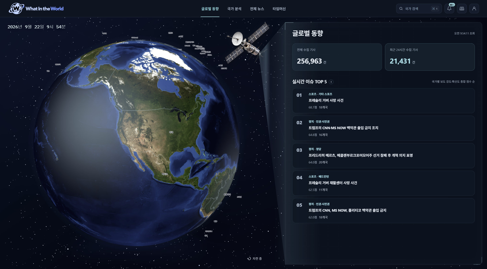
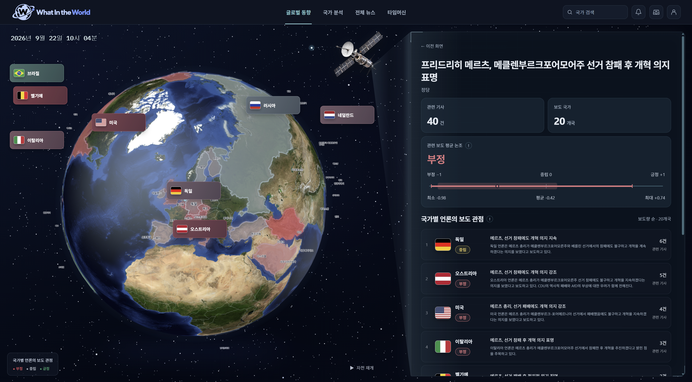
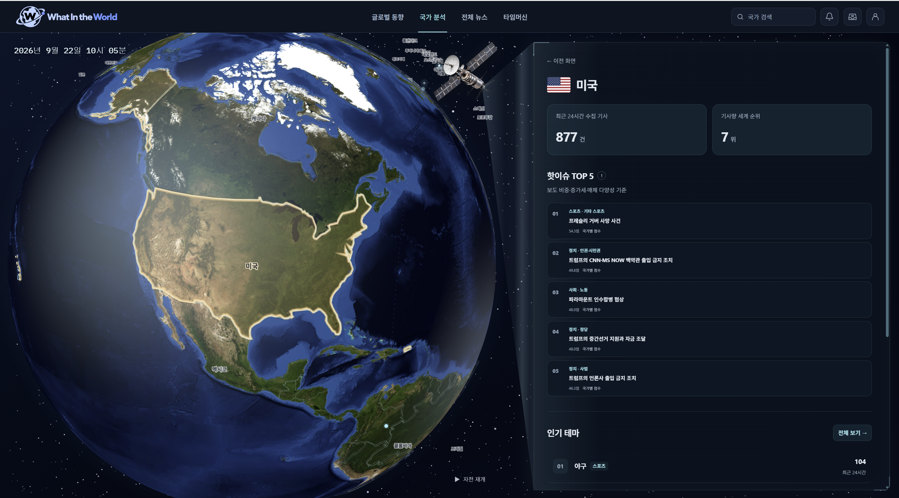
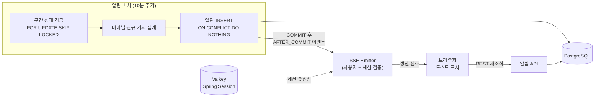

<div align="center">
  <h1>🌍 What In the World</h1>
  <p><strong>세계의 이슈를 찾고, 같은 사건을 바라보는 나라별 시각을 비교하다</strong></p>
  <p>전 세계 뉴스에서 주요 이슈를 뽑아 국가별 보도 현황과 논조를 비교하는 뉴스 분석 서비스<br>
  3D 지구본으로 국가를 탐색하고, 관심 테마의 새 소식을 실시간 알림으로 받습니다.</p>

  <p>
    
    
    
    
    
    
    
    
    
  </p>

  <p>🏆 <strong>SSAFY 15기 특화 프로젝트 우수상</strong></p>

  <p>SSAFY 15기 특화 프로젝트 · 6인 · 7주<br>
  <strong>강석진 — 회원 인증·인가 / 관심 테마 실시간 알림 (Backend + 연동 Frontend)</strong></p>
</div>

<br>

> [!NOTE]
> SSAFY GitLab에서 팀으로 개발한 프로젝트를 커밋 이력과 함께 옮긴 저장소입니다.
> 뉴스 수집·분석과 지구본 시각화는 팀원들의 작업이고, **이 README의 기여·트러블슈팅은 제가 맡은 인증과 알림 영역**입니다.

<p align="center">
  <a href="#-서비스-소개">서비스 소개</a> ·
  <a href="#-담당-역할">담당 역할</a> ·
  <a href="#-트러블슈팅">트러블슈팅</a> ·
  <a href="#-알림-아키텍처">알림 아키텍처</a> ·
  <a href="#-기술-스택">기술 스택</a> ·
  <a href="#-회고">회고</a>
</p>

<br>

## 🖥 서비스 소개

| 🌐 글로벌 동향 · 실시간 이슈 TOP 5 | 🔍 이슈별 국가 논조 비교 |
| :---: | :---: |
|  |  |
| 3D 지구본과 TOP 5 이슈, 최근 24시간 수집 현황 | 기사 수·보도 국가·긍정/중립/부정 논조를 국가별로 비교 |

| 🗺 국가별 대시보드 | 🔔 관심 테마 알림 |
| :---: | :--- |
|  | 회원이 관심 테마를 설정하면 10분 단위로 새 기사를 집계해 알림 생성<br><br>새 알림이 저장되면 접속 중인 화면에 **SSE로 갱신 신호** → 토스트 표시<br><br>읽은 알림은 목록에서 제외 |
| 국가별 핫이슈 TOP 5, 인기 테마, 타임머신 | |

<sub>화면은 프로젝트 당시 실제 서비스 캡처이며, 수치와 뉴스는 촬영 시점 데이터입니다. 논조는 분석 결과일 뿐 사실 여부를 판정하는 지표가 아닙니다.</sub>

<br>

## 🙋 담당 역할

| 영역 | 구현 내용 | 대표 커밋 |
| :-- | :-- | :-- |
| **이메일 회원가입** | 이메일 중복 검사, 인증 코드 발송·검증(시도 횟수 제한), 인증 완료 확인 후 가입 | [`aa3ac42`](https://github.com/doljeen/What-In-the-World/commit/aa3ac429376f4da3dd2a036babd2ecc78c588c61) |
| **세션 기반 인증** | Spring Security + Spring Session(Valkey) 로그인·로그아웃, 내 정보, 탈퇴·재가입 | [`668d98a`](https://github.com/doljeen/What-In-the-World/commit/668d98aa5ef4b1b59117f3ea595d5e6f39a3cf6b) · [`f41b6d0`](https://github.com/doljeen/What-In-the-World/commit/f41b6d061d73c7f84523a41d385e590bdd353d76) |
| **비밀번호 관리** | 재설정 인증 코드, 재설정, 로그인 사용자 비밀번호 변경 | [`2956aa5`](https://github.com/doljeen/What-In-the-World/commit/2956aa557b9e82c072b583c581a2b1ec5aece52d) |
| **SSAFY OAuth** | 소셜 로그인·가입, 탈퇴 회원 재가입, 접속 도메인 기준 콜백 URL | [`0634ef9`](https://github.com/doljeen/What-In-the-World/commit/0634ef911be981bcd78a19ed2049685629cee0a3) · [`2bc286f`](https://github.com/doljeen/What-In-the-World/commit/2bc286f49f8813ccbb73dbe235865a2150a845e0) |
| **관심 테마 알림 API** | 전체·테마별 수신 설정, 목록·미확인 수 조회, 읽음·전체 읽음·삭제 | [`21cc020`](https://github.com/doljeen/What-In-the-World/commit/21cc0202861ba3661e81acd6ea666d9b5aa68bae) · [`49374de`](https://github.com/doljeen/What-In-the-World/commit/49374de2f49b3827e9596ab8604cea382e18ee62) |
| **알림 생성 배치** | 10분 구간별 기사 집계 SQL, 처리 구간 관리, 중복 방지 제약 | [`4502116`](https://github.com/doljeen/What-In-the-World/commit/450211646811fd591ed90eacab250bf3d613cf80) · [`177b469`](https://github.com/doljeen/What-In-the-World/commit/177b469ff52d53459c0027b55c8c312fd1f40f48) |
| **SSE · 화면 연동** | 세션 검증 SSE 구독, 커밋 후 갱신 이벤트, 알림 토스트·설정 UI | [`bd19c42`](https://github.com/doljeen/What-In-the-World/commit/bd19c421c670f9ca734fe88e160aa9a10f7bbae5) · [`c72d438`](https://github.com/doljeen/What-In-the-World/commit/c72d43803f85dfb9adaa70d3b49ef16775e7e78c) |

<br>

## 🔥 트러블슈팅

> 각 항목은 **문제 → 원인 → 해결 → 결과** 순서로 정리했습니다. 별도 성능 측정을 하지 않은 항목에는 개선율을 적지 않았습니다.

### 1. 비밀번호 재설정 인증 시도 횟수 제한이 동작하지 않음

| | |
| :-- | :-- |
| **문제** | 비밀번호 재설정 인증 코드를 계속 틀려도 시도 횟수 제한(브루트포스 방지)에 걸리지 않음 |
| **원인** | 회원가입·비밀번호 재설정이 공유하는 `increaseTryCount()`가 파라미터를 무시하고 **회원가입용 Redis 키에 카운트를 올리고 있었음** → 재설정 카운트는 항상 0, 회원가입 카운트는 엉뚱하게 증가 |
| **해결** | 호출한 흐름의 키 prefix를 그대로 사용하도록 수정 |
| **결과** | 회원가입(`auth:email:signup:try:*`)과 재설정(`auth:email:password:try:*`)의 시도 횟수가 분리되어 각각 제한 동작 |

```diff
  private void increaseTryCount(String email, String codeKey, String tryKeyPrefix) {
-     String tryKey = TRY_KEY_PREFIX + email;     // 항상 회원가입 키
+     String tryKey = tryKeyPrefix + email;       // 호출한 흐름의 키
      Long count = redisTemplate.opsForValue().increment(tryKey);
```

> **배운 점** — 한 글자짜리 버그였지만 보안 기능이 "조용히" 꺼져 있던 상황이었습니다. 공통 메서드로 추출할 때 파라미터가 실제로 쓰이는지 확인하고, 제한 로직은 흐름별로 테스트해야 한다는 걸 배웠습니다.

📎 [`c1a5904`](https://github.com/doljeen/What-In-the-World/commit/c1a59047e765efa23d2e995cdf307f764b4933ca)

---

### 2. 탈퇴한 회원이 SSAFY 계정으로 재가입할 수 없음

| | |
| :-- | :-- |
| **문제** | 탈퇴한 회원이 SSAFY OAuth로 다시 가입하면 `AUTH_PROVIDER_CONFLICT` 에러 |
| **원인** | 탈퇴를 논리 삭제로 처리해 이메일이 DB에 남아 있음. 가입 시 이메일이 존재하기만 하면 **탈퇴 여부와 관계없이** 충돌로 판단 |
| **해결** | SSAFY 식별자 조회와 이메일 조회를 분리하고, 이메일 계정이 **탈퇴 상태면 기존 사용자 ID를 유지한 채 재활성화**. 활성 계정과의 가입 방식 충돌만 에러 처리 |
| **결과** | 탈퇴 → SSAFY 재가입 흐름이 정상 동작함을 실제 서비스에서 확인 |

```diff
- if (userRepository.findByEmailIgnoreCase(email).isPresent())
-     throw new GlobalException(ErrorCode.AUTH_PROVIDER_CONFLICT);
+ User emailUser = userRepository.findByEmailIgnoreCase(email).orElse(null);
+ if (emailUser != null) {
+     if (!emailUser.isWithdrawn()) throw new GlobalException(ErrorCode.AUTH_PROVIDER_CONFLICT);
+     emailUser.reactivateSsafy(providerId);   // 탈퇴 계정은 재활성화
+     return emailUser.getId();
+ }
```

> **돌아보면** — 논리 삭제를 택한 구조 때문에 생긴 문제입니다. 데이터 복원 요구가 명확하지 않았다면 물리 삭제 + 연관 데이터 정리가 더 단순했을 수 있습니다. 삭제 정책은 구현 전에 합의해야 한다는 걸 배웠습니다.

📎 [`2bc286f`](https://github.com/doljeen/What-In-the-World/commit/2bc286f49f8813ccbb73dbe235865a2150a845e0)

---

### 3. 알림이 DB에 커밋되기 전에 화면이 먼저 갱신될 수 있음

| | |
| :-- | :-- |
| **문제** | 트랜잭션 안에서 SSE를 보내면, 클라이언트가 재조회했을 때 **아직 커밋되지 않은 알림은 보이지 않음** (신호는 왔는데 목록은 그대로) |
| **원인** | "알림 저장"과 "SSE 전송" 시점이 같은 트랜잭션 안에 묶여 있어, 커밋보다 전송이 먼저 일어날 수 있음 |
| **해결** | 알림 생성 후 도메인 이벤트만 발행하고, `@TransactionalEventListener(AFTER_COMMIT)`에서 SSE 전송. 이벤트에는 데이터가 아닌 **갱신 신호만** 담고, 프론트는 REST API로 재조회 |
| **결과** | 화면의 목록·미확인 개수가 항상 DB에 저장된 결과와 일치 |

```text
기사 집계 → 알림 INSERT → 트랜잭션 COMMIT → (AFTER_COMMIT) SSE 갱신 신호 → 프론트가 알림 API 재조회
```

```java
@TransactionalEventListener(phase = TransactionPhase.AFTER_COMMIT)
public void handle(NotificationsCreatedEvent event) { /* 대상 사용자에게 SSE 신호 전송 */ }
```

> **트레이드오프** — 이벤트에 알림 전체를 담는 방식보다 요청이 한 번 더 생기지만, 화면 상태를 서버 저장 결과 하나에 맞출 수 있습니다. SSE는 "갱신하라는 신호"일 뿐 전달을 보장하는 메시지 큐는 아닙니다.

📎 [`c72d438`](https://github.com/doljeen/What-In-the-World/commit/c72d43803f85dfb9adaa70d3b49ef16775e7e78c)

---

### 4. 배치가 같은 구간을 다시 처리하면 알림이 중복 생성될 수 있음

| | |
| :-- | :-- |
| **문제** | 스케줄러 재시작·재처리 또는 서버가 여러 대일 때 같은 10분 구간이 두 번 처리되면 **같은 알림이 중복 생성** |
| **원인** | 알림 생성이 "몇 번 실행되어도 결과가 같은"(멱등) 구조가 아니었음 |
| **해결** | ① DB 유일 제약 + `ON CONFLICT DO NOTHING` ② 처리 구간 상태 행을 `FOR UPDATE SKIP LOCKED`로 잠가 동시 처리 방지 ③ 알림 생성과 다음 구간 갱신을 **한 트랜잭션**으로 처리 |
| **결과** | 같은 구간을 다시 실행해도 알림이 한 번만 생성되는 멱등 배치 |

```sql
-- 같은 사용자 · 테마 · 집계 구간의 알림은 한 번만
INSERT INTO notification (...) SELECT ...
ON CONFLICT (user_id, theme_id, period_start, period_end) DO NOTHING;

-- 다른 인스턴스가 처리 중이면 기다리지 않고 건너뜀
SELECT next_period_start FROM notification_job_state
WHERE job_name = ? FOR UPDATE SKIP LOCKED;
```

> **트레이드오프** — 10분 단위로 묶어 보내므로 기사 1건마다 즉시 알리는 구조는 아닙니다. 처리 유예 시간을 두었지만 아주 늦게 수집된 기사까지 보장하지는 않습니다.

📎 [스키마 `975825a`](https://github.com/doljeen/What-In-the-World/commit/975825a24de8a3c625514fc243c11c34c90a28d3) · [배치 `177b469`](https://github.com/doljeen/What-In-the-World/commit/177b469ff52d53459c0027b55c8c312fd1f40f48)

---

### 5. 운영 도메인에서 로그인하면 개발 도메인으로 튕김

| | |
| :-- | :-- |
| **문제** | 운영 사이트(`witw.kro.kr`)에서 SSAFY 로그인 후 개발 사이트(`dev.witw.kro.kr`)로 리다이렉트 |
| **원인** | OAuth 콜백 URL이 프론트 코드에 **개발 도메인으로 하드코딩** |
| **해결** | 접속한 `location.origin` 기준으로 콜백 URL을 생성하고, 두 도메인 모두에 대한 테스트 추가 |
| **결과** | 운영·개발 도메인 각각에서 로그인 후 원래 도메인으로 복귀 |

```diff
- const SSAFY_REDIRECT_URI = 'https://dev.witw.kro.kr/auth/ssafy/callback';
- url.searchParams.set('redirect_uri', SSAFY_REDIRECT_URI);
+ url.searchParams.set('redirect_uri', `${location.origin}/auth/ssafy/callback`);
```

> **배운 점** — 코드만 고치면 끝이 아니었습니다. 배포 브랜치와 **실제 배포된 번들**에 반영됐는지 확인해야 했고, OAuth 제공자의 허용 콜백 목록과 백엔드 토큰 교환 설정도 함께 맞아야 했습니다.

📎 [`1df84d9`](https://github.com/doljeen/What-In-the-World/commit/1df84d98fd1a0f04cc284e4433f7f15ab856315a) · [`bdcc16d`](https://github.com/doljeen/What-In-the-World/commit/bdcc16d783f43a3d51f5ed5f81eed7fc90d1db9c)

---

### 그 밖의 이슈

| 증상 | 원인 | 해결 |
| :-- | :-- | :-- |
| 로그아웃·세션 만료 후에도 SSE 연결이 남을 수 있음 | 연결 종료 시점과 세션 상태를 함께 관리해야 함 | 사용자 + 세션을 함께 검증, 종료·타임아웃·오류 시 emitter 정리, heartbeat 때도 세션 유효성 확인 ([`bd19c42`](https://github.com/doljeen/What-In-the-World/commit/bd19c421c670f9ca734fe88e160aa9a10f7bbae5)) |
| 읽은 알림이 목록에 계속 쌓임 | 목록 조회가 삭제 여부만 확인 | 읽음 처리 시 목록에서 제외하도록 조회 조건·상태 변경 ([`f575e96`](https://github.com/doljeen/What-In-the-World/commit/f575e967bc16478ff46afa3116f03ed92082b284)) |

<br>

## 🔔 알림 아키텍처



<br>

## 🛠 기술 스택

### 직접 사용한 기술과 선택 이유

| 기술 | 선택 이유 |
| :-- | :-- |
| **Spring Boot** | 회원·알림 API와 트랜잭션·이벤트·스케줄링을 한 애플리케이션에서 관리 |
| **Spring Security + Spring Session + Valkey** | 인증과 서버 측 세션 관리를 연계하고, 같은 세션 정보로 SSE 연결 유효성도 검증 |
| **JPA + PostgreSQL** | 회원·설정은 JPA, 알림 집계는 네이티브 SQL과 DB 유일 제약으로 중복 방지 |
| **SSE** | 서버 → 브라우저 단방향 알림이면 충분해 WebSocket보다 단순한 SSE 선택 |
| **React** | 담당 기능의 API를 화면 상태·토스트에 연결 |

### 팀 전체 시스템

| 영역 | 구성 |
| :-- | :-- |
| 웹 화면 | React · Vite · Three.js |
| API | Java 21 · Spring Boot · PostgreSQL · Valkey |
| 수집 · 분석 | Python · Kafka · Spark · HDFS |
| 배포 · 관측 | Docker · Nginx · GitLab CI/CD · Prometheus · Grafana · Loki |

<sub>팀 전체 시스템을 혼자 구현한 것은 아닙니다. 개인 기여는 위 담당 역할과 커밋 기준입니다.</sub>

<br>

## 💭 회고

**잘한 점**
- 인증을 "로그인 성공"이 아니라 **가입 → 탈퇴 → 재가입**까지 계정 상태가 바뀌는 전체 흐름으로 다뤘습니다.
- 알림을 API로 끝내지 않고 **저장 시점과 전송 시점, 연결 정리**까지 맞췄습니다.

**아쉬운 점 / 다음에 할 것**
- [ ] 회원 데이터의 보존·삭제 정책을 구현 전에 합의하기
- [ ] SSE 연결이 서버 메모리에 있어 다중 서버 확장 시 서버 간 이벤트 전달(Pub/Sub) 설계 필요
- [ ] 지연 수집 데이터의 재처리 기준을 요구사항 단계에서 정하기
- [ ] 인증 시도 제한 같은 보안 로직은 흐름별 테스트를 먼저 작성하기

<br>

## 📁 폴더 구조

```text
What-In-the-World
├── backend/      회원 · 인증 · 알림 등 Spring Boot API
├── frontend/     서비스 화면과 API 연동 (React · Three.js)
├── bigdata/      뉴스 수집 · Kafka · Spark · NLP 워커 (팀)
├── ml/           분석 모델 (팀)
├── infra/        Nginx · 모니터링 설정
├── sql-files/    초기 데이터
└── DOCS/         API 명세, ERD, 요구사항, 설계 문서
```

<details>
<summary><b>로컬 실행 (참고)</b></summary>

```bash
# Frontend
cd frontend
npm ci
npm run dev
npm test

# Backend (Java 21)
cd backend
./gradlew bootRun
```

DB · Valkey · 메일 · OAuth 등 외부 설정이 필요합니다. 각 폴더의 Compose 파일(`backend/docker-compose.*.yml` 등)을 참고해 개인 환경에 맞게 설정하세요. 비밀키는 저장소에 포함하지 않았습니다.

</details>

<br>

<sub>원본은 SSAFY GitLab 운영 `master` 기준이며 `develop` 브랜치와 태그 이력도 `archive/gitlab/*` 브랜치로 보존했습니다. GitHub로 옮기며 작성자 이메일을 정리해 커밋 SHA가 원본과 다릅니다. CI 설정(`.gitlab-ci.yml`)은 개발 당시 기록이며, 이 저장소에서는 자동 배포가 동작하지 않습니다.</sub>
